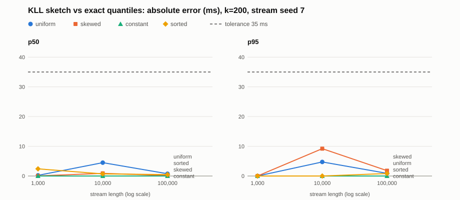

# Streaming quantile summary (KLL sketch)

The telemetry tool used to compute p50 and p95 by sorting the whole stream
(`telemetry_stats.exact_quantile`). That means holding every value in memory.
`kll_sketch.py` adds an approximate summary that keeps a small, bounded set of
items and still answers p50/p95 within a stated error.

## Files

| File | What it is |
|------|------------|
| `telemetry_stats.py` | Existing exact nearest-rank quantile (unchanged) |
| `streams.py` | Existing seeded latency stream, values in 0-1000 ms (unchanged) |
| `kll_sketch.py` | KLL sketch (Karnin, Lang & Liberty, 2016), standard library only |
| `compare_quantiles.py` | Reproducible comparison against exact p50/p95 |
| `results/quantile_comparison.csv` | One row per stream x length x k |
| `results/accuracy_plot.svg` | Absolute error vs stream length, p50 and p95, k=200 |

Run it with `python compare_quantiles.py` (Python 3.8+, no extra packages).
It takes a few seconds.

## How the sketch works

Values go into level 0. An item at level `h` stands for `2**h` original values.
Each level has a capacity of `max(2, ceil(k * c**depth))`. The top level holds
`k` items and each level below holds about `c = 2/3` as many. When the total
reaches the summed capacity, the first full level is sorted and every other
item is promoted one level up. The random offset (0 or 1) is drawn from a
seeded generator. Total weight always equals the number of values seen, so
queries use the same nearest-rank rule as the exact function: return the first
item whose cumulative weight reaches `ceil(q * n)`.

## What is checked

The checks use fixed seeds: stream seed 7 and sketch seed 42. There are four
streams (uniform, skewed exponential with mean 100 ms, constant 250 ms, and
sorted uniform), each at lengths 1,000, 10,000 and 100,000.

- **Accuracy:** absolute error of p50 and p95 versus exact, against a 35 ms
  tolerance.
- **Monotonic:** estimated p50 <= estimated p95.
- **Memory:** the peak number of retained items, tracked on every update, stays
  under `memory_bound()`.
- **Reproducible:** the sketch is built twice from the same seeds, and the
  SHA-256 digests of the full state (every retained item at every level) must
  match. The CSV and SVG are byte-identical across runs.

### Why 35 ms

The tolerance was chosen before running anything. Apache DataSketches
publishes a normalized rank error of about 1.65% (99% confidence) for its
tuned KLL at k=200. This simpler implementation isn't guaranteed to match that
figure exactly; the measured errors below are the actual evidence. A rank error turns into
a value error of `rank error / density`. Across the four streams, the sparsest
point we query is skewed p95: an exponential with mean 100 has density 0.05/100
= 0.0005 per ms there. That gives 0.0165 / 0.0005 = 33 ms, rounded up to 35 ms.
Uniform and sorted streams have density 0.001 per ms, so they should land near
16 ms or less. The constant stream must be exact.

## Results (k = 200)

All checks pass. The worst error is 9.2 ms, at skewed p95 with n=10,000. The
constant stream is exact at every length. At n=1,000 the sketch has done only
a few compactions, and p95 came out exact for every stream.

## Accuracy vs memory trade-off

`k` is the single knob. Memory grows linearly with `k`, and error shrinks
roughly in proportion to `1/k`. The error trend is indicative only: it comes
from one seed at one length.

| k | Peak items at n=100,000 | Worst absolute error at n=100,000 |
|---|---|---|
| 50 | 153 | 12.4 ms |
| 100 | 298 | 4.3 ms |
| 200 | 588 | 1.8 ms |

Exact quantiles for the same stream hold all 100,000 values. The k=200 sketch
holds under 600, about 0.6% of the stream, and stays within about 2 ms here.

## Memory behavior and bound

- Retained items grow only with the number of levels, which is about
  `log2(n / k)`. They do not grow with `n` itself. In the runs above the peak
  went 423 -> 550 -> 588 as `n` went 1k -> 10k -> 100k.
- Hard bound: the summed capacities are below `3k + 2H`, and the level count
  `H` never exceeds `log2(n)`. So for any stream under 2^32 values, the peak is
  at most `3k + 64` items (664 for k=200).
- Each item is one Python float. Memory in bytes is that count times the
  per-object overhead. The sketch never stores the stream.

## Limits

- **Approximate, probabilistic.** The error guarantee is about rank, not
  value, and holds with high probability, not always. A different sketch seed
  gives slightly different estimates.
- **Value error depends on the data.** In sparse regions such as long tails,
  a small rank error becomes a large value error. That is why skewed p95 is the
  worst case. Extreme tails (p99.9) need a larger `k`, or a sketch built for
  relative error.
- **Bounded synthetic streams only.** Every value lies in 0-1000 ms, and the
  tolerance is tuned to these four distributions. Real telemetry should get its
  tolerance from its own density near p95.
- **Answers are retained values.** Estimates are always real observed values,
  never interpolated, which matches the nearest-rank exact definition.
- **Not thread-safe, no merge.** One sketch per stream, single writer. KLL
  supports merging, but this implementation does not include it.
